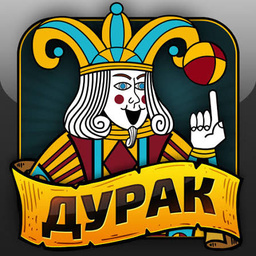

<div align="center">



# Durak NX

**Durak for Nintendo Switch.**

Unity 6 · ARM64 IL2CPP · Horizon OS / Atmosphère


[Install](#installation) · [Controls](#controls) · [Status](#status) · [Build](#building-from-source) · [Report a bug](https://github.com/Oleksa126/durak_nx/issues)

</div>

Durak NX loads the original Android game's ARM64 libraries and connects them to Switch graphics, audio, files and input. It runs under Horizon OS without installing or booting Android.

> [!IMPORTANT]
> Bring your own copy of **Durak 25.0** (`ru.appscraft.durak`, versionCode `250`). The Android package, extracted game libraries and game data are not included in this repository. Other versions are not supported by the target verification checks.

## Screenshots

<table>
  <tr>
    <td></td>
    <td></td>
  </tr>
  <tr>
    <td></td>
    <td></td>
  </tr>
</table>

*Official Android promotional images from [the game's Google Play listing](https://play.google.com/store/apps/details?id=ru.appscraft.durak&hl=en_US), linked from Google's image servers. These show the original game, not Switch captures or measured Switch performance. The Switch UI may differ. Images belong to their respective owners; no generated images are used.*

## Features

- The original Unity game running through a per-title compatibility layer.
- Main menu, game-mode selection and gameplay confirmed on a Switch.
- Touch input in handheld mode and a controller-driven virtual cursor.
- OpenSL ES audio routed through SDL; game sound confirmed on hardware.
- Local game data and saves on the SD card.
- Target-specific library verification, instruction fingerprints and runtime logging.

## What you need

| Requirement | Details |
| --- | --- |
| Console | Nintendo Switch with Atmosphère and the Homebrew Menu. Hardware testing has been performed on Switch OLED. |
| Launch mode | Application mode / title override: hold **R** while launching an installed game to open the Homebrew Menu. |
| Game | Your own exact supported **Durak 25.0** Android package, with ARM64 libraries. |
| Build environment | Windows with WSL Ubuntu, Docker and Python; see [build instructions](docs/BUILD.md). |

## Installation

This repository distributes source. Build and assemble your own SD package using your local game files:

1. Clone this repository and install the prerequisites in the [build guide](docs/BUILD.md).
2. Place your supported package at the repository root as `Durak_25.0.apks`. It stays local and is ignored by Git.
3. Extract and verify the game files:

   ```powershell
   python -m pip install pyelftools UnityPy==1.25.3
   python tools/extract_game.py --apks Durak_25.0.apks --out extracted_durak
   ```

   The extractor checks the package, version, library hashes and metadata. A different archive may be rejected even if its display version is 25.0; do not bypass those checks.

4. Build and package from the repository root:

   ```powershell
   powershell -ExecutionPolicy Bypass -File scripts/build_nro.ps1
   ```

5. Copy the generated `build/switch/` folder into the root of your SD card, merging folders and replacing application files.
6. Open the Homebrew Menu through title override and launch **Durak NX**.

> [!NOTE]
> The package you build locally contains your extracted game files. Keep it private. To update an existing installation, merge folders; do not delete the existing `durak_nx` directory or its saves.

The generated SD layout includes:

```text
sd:/switch/durak_nx/
├── durak_nx.nro
├── game/
│   ├── lib/
│   │   ├── libmain.so
│   │   ├── libunity.so
│   │   ├── libil2cpp.so
│   │   └── libsqlite3.so
│   └── assets/
├── assets/                  # Compatibility copy produced by packaging
└── durak_nx.log              # Created at runtime
```

## Controls

| Input | Action |
| --- | --- |
| Touch screen | Tap and drag the game's interface in handheld mode. |
| Left stick | Move the virtual cursor. |
| A | Press at the cursor; hold while moving to drag. |
| + | Request the current game's menu. This path still has a hardware-validation gate. |

## Status

**v0.1.0 is experimental.** The project log records working menu, gameplay and sound on Switch. Individual recent changes have separate validation gates; a successful build does not prove every path works on hardware.

| Area | Evidence / state |
| --- | --- |
| ELF loading, constructors and JNI bootstrap | Confirmed on Switch. |
| Unity graphics, menu and gameplay | Confirmed on Switch. |
| Single Game / SQLite startup | Confirmed on Switch. |
| Game audio | Confirmed on Switch. |
| Touch and controller cursor | Implemented; feedback across play modes is welcome. |
| Recent loading, menu, cosmetic and Plus-button changes | Some gates still require hardware testing; see the [project log](IMPLEMENTATION_PLAN.md). |
| Online services | Not a supported feature of this port. |
| Other game versions, full completion, suspend/resume | Not established by current testing. |

## Troubleshooting

- **Package verification fails:** use the exact supported target. See [target evidence](docs/TARGET_EVIDENCE.md) and the checks in `tools/extract_game.py`.
- **Missing library or asset:** rebuild the SD package and copy the whole generated `switch` folder, including both asset paths.
- **Startup failure or a blank screen:** use title override and attach `sd:/switch/durak_nx/durak_nx.log` to an [issue](https://github.com/Oleksa126/durak_nx/issues).
- **Reporting a bug:** include console model, Atmosphère version, build identity, launch mode, reproduction steps and the runtime log. Do not attach APKs, libraries, game data or personal saves.

## Building from source

The root `Makefile` builds `durak_nx.nro`. Active code lives in `source/`, headers in `include/` and host checks in `tests/`. The Docker toolchain is pinned in `toolchain.lock`.

See [docs/BUILD.md](docs/BUILD.md) for Windows and Linux/WSL workflows. Windows packaging requires UnityPy 1.25.3 and the locally extracted game. `build/manifest.json` records file hashes and the source commit.

[IMPLEMENTATION_PLAN.md](IMPLEMENTATION_PLAN.md) is the single development plan and hardware-gate log. Technical reports in `docs/` preserve evidence and historical analysis.

## Credits and notices

- **Durak** — the original Android game. This is an independent, unofficial Nintendo Switch port.
- [NaGaa95/laytonbmr_nx](https://github.com/NaGaa95/laytonbmr_nx) — primary runtime reference and donor; [MIT license](third_party/laytonbmr_nx/LICENSE).
- [ChanseyIsTheBest/cloverpit_nx](https://github.com/ChanseyIsTheBest/cloverpit_nx) — additional Unity/Switch reference; [MIT license](third_party/cloverpit_nx/LICENSE).
- devkitPro, libnx, Mesa, SDL and the Switch homebrew community.
- [SantiBros/NFSMostWanted2012-Android-Switch](https://github.com/SantiBros/NFSMostWanted2012-Android-Switch) — README presentation reference.

Upstream copyright notices and licenses are retained. See [provenance](docs/UPSTREAM_PROVENANCE.md) for pinned donor snapshots. No blanket license is asserted here for the original game's files or artwork.
